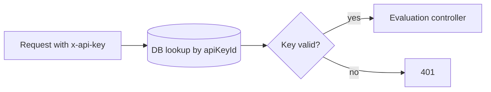
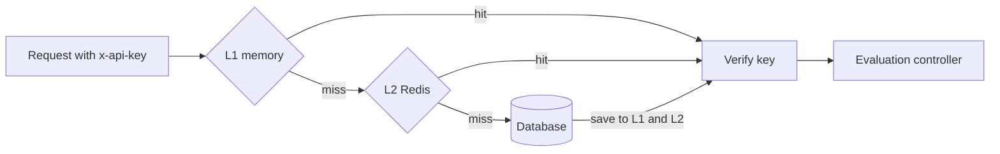
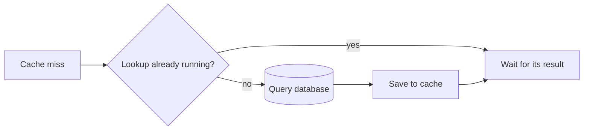
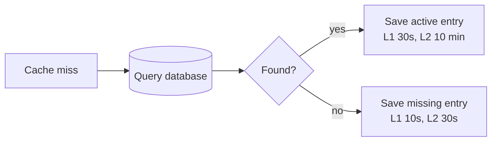

# API key verification (v1)

How the flag evaluation API verifies the API key on each request, and why this first version won't hold up at scale.

## API key format

Keys look like `fk_<apiKeyId>_<secret>` (see [api-key.ts](../apps/api/src/lib/api-key.ts)).

- `apiKeyId` is public. It is stored in plaintext and used to find the project.
- `secret` is never stored. Only an HMAC-SHA256 of the whole key (peppered) is stored as `apiKeyHash`.

## v1 flow

The `authenticateApiKey` hook ([auth.ts](../apps/api/src/plugins/auth.ts)) runs on `onRequest` for the evaluate routes. It does a database lookup on **every** request.



On success the hook sets `request.projectId` and `request.accountId`. Malformed, unknown and mismatched keys all return the same 401.

## The problem

Let's say, evaluation traffic is around **10K requests per second**.
With a database lookup on every request:

- Each evaluation pays a database round trip before any work starts.
- The database load grows one-to-one with evaluation traffic, even though the key-to-project mapping rarely changes.
- The evaluate endpoint's availability and latency depend on the database.

We need to verify keys without querying the database on every request.

## V2 flow

To avoid hitting the database on every request, v2 adds a two-level cache in front of it.

- **L1:** in-memory cache on each API server.
- **L2:** Redis, shared by all API servers.

On each request we check L1 first. On a miss we check Redis. If Redis also misses, we read from the database and save the result in both caches.



## L2 Redis cache

L1 is per server, so every server has to fill its own cache and each one hits the database for the same keys. Redis is shared, so once one server has loaded a key, the others get it from Redis instead of the database.

Redis is only a cache, so it must never slow down or break the evaluate endpoint. These are the rules:

- **Best effort:** if Redis is down, slow, or returns a bad value, we treat it as a cache miss and read from the database. Failed writes and deletes are ignored.
- **Fail fast:** commands have a 200ms timeout and aren't queued while Redis is disconnected, so a dead Redis can't pile up requests. For example, requests in the first few milliseconds after startup go straight to the database.
- **Validated values:** what we read from Redis is parsed and checked against a schema, so a corrupted or old-shaped value is a miss, not a crash.
- **Shared with coalescing:** the Redis read is inside the coalescer, so concurrent misses for a key share one Redis read and one database query.

The code is in `apps/api/src/lib/cache`: `RedisCache` is the generic class, `redis.ts` is the client, and `api-key-cache.ts` puts L1, Redis and the database together.

## Cache schema

**Key**

```
apikey:<apiKeyId>
```

It uses the public `apiKeyId`, never the full key, so no secret ends up in Redis keys or logs. L1 and L2 use the same key.

**Value**

Right now only found keys are cached, so an entry is:

```ts
type ApiKeyCacheEntry = { projectId: string; accountId: string; apiKeyHash: string };
```

It has everything the verification needs. We still compare the HMAC of the presented key against `apiKeyHash` on every request. That's cheap and in-process, so the cache only replaces the database lookup.

Every entry has a `status` field (negative caching):

```ts
type CacheEntry =
  | { status: "active"; value: { projectId: string; accountId: string; apiKeyHash: string } }
  | { status: "missing" };
```

`missing` is for well-formed `apiKeyId`s that aren't in the database. It stops random keys from hitting the database on every request.

In Redis the value is stored as a JSON string.

**TTLs**

| Entry     | L1 (memory) | L2 (Redis) |
| --------- | ----------- | ---------- |
| `active`  | 30s         | 10 min     |
| `missing` | 10s         | 30s        |

L1 has a max size (LRU), so a flood of different keys can't grow memory.

**Revocation**

When a key is rotated or a project is deleted, we delete the key from Redis and publish the `apiKeyId` on a pub/sub channel so every server evicts it from L1. If that message is missed, a revoked key can still work for at most the L1 TTL (30s). That's the delay we accept.

We're building this gradually. L1, L2, request coalescing, pub/sub invalidation and negative caching are done.

## Optimizations

### Request coalescing for concurrent misses

**Problem**

The cache only helps after the first request has filled it. If a key isn't cached and many requests for it arrive at the same time (cold start, or right after the TTL expires), all of them miss and all of them query the database. At 10K requests per second that can be hundreds of identical queries for one key.

**Solution**

Request coalescing. We keep a map of lookups that are currently running, one per `apiKeyId`. On a cache miss:

1. If a lookup for this `apiKeyId` is already running, wait for it and use its result.
2. If not, start the database query and put its promise in the map.
3. When the query finishes, remove it from the map, whether it succeeded or failed.

So all the concurrent requests share one query.



Some things to keep in mind:

- The check and the set on the map must happen with no `await` in between. Otherwise two requests can both think nobody is running a lookup.
- The map entry must be removed in a `finally`. If the query fails and we don't remove it, every later request for that key gets the same failed promise.
- Only the Redis read and the database read are shared. Each request still verifies its own key against the hash.
- If the query fails, everyone waiting gets the error, and the next request tries again.

### Negative caching for unknown keys

**Problem**

The cache only stores keys that exist. If a request comes with a key that isn't in the database (a typo, a deleted project, someone guessing), every one of those requests misses the cache and queries the database, and then gets a 401. An attacker can send random keys all day, and each one costs us a database query.

**Solution**

We also cache the fact that a key doesn't exist. When the lookup finds nothing, we store a `{ status: "missing" }` entry instead of skipping the cache. The next request with the same `apiKeyId` gets "not found" from the cache and never reaches the database.



Some things to keep in mind:

- `missing` entries have a short TTL. If a key is valid a moment later, we don't want to keep rejecting it for long.
- Nothing needs to invalidate a `missing` entry for API keys. The `apiKeyId` is random, so nobody can look up a key before it exists.
- Random keys can't grow memory forever, because L1 is an LRU with a max size. They only push out old entries.
- A `missing` entry means the key is unknown. The key is still compared against the hash on every request, same as before, and the response is the same 401 as for a wrong key.
- Old Redis entries without a `status` fail the schema check, so they count as a miss and get rewritten in the new shape.
