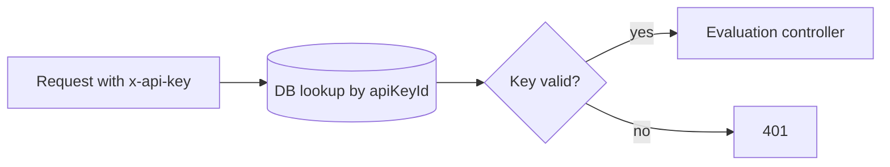
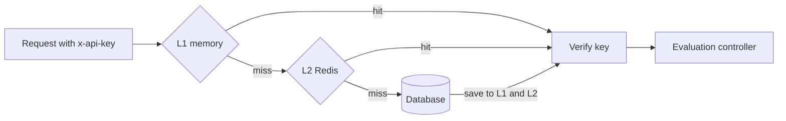

# API key verification (v1)

How the flag evaluation API verifies the API key on each request, and why this first version won't hold up at scale.

## API key format

Keys look like `fk_<apiKeyId>_<secret>` (see [api-key.ts](../apps/api/src/lib/api-key.ts)).

- `apiKeyId` is public. It is stored in plaintext and used to find the project.
- `secret` is never stored. Only an HMAC-SHA256 of the whole key (peppered) is stored as `apiKeyHash`.

## v1 flow

The `authenticateApiKey` hook ([auth.ts](../apps/api/src/plugins/auth.ts)) runs on `onRequest` for the evaluate routes. It does a database lookup on **every** request.

On success the hook sets `request.projectId` and `request.accountId`. Malformed, unknown and mismatched keys all return the same 401.

## The problem

Let's say, evaluation traffic is around **10K requests per second**.
With a database lookup on every request:

- Each evaluation pays a database round trip before any work starts.
- The database load grows one-to-one with evaluation traffic, even though the key-to-project mapping rarely changes.
- The evaluate endpoint's availability and latency depend on the database.

We need to verify keys without querying the database on every request.

## V2 flow

To avoid hitting the database on every request, v2 adds a two-level cache in front of it.

- **L1:** in-memory cache on each API server.
- **L2:** Redis, shared by all API servers.

On each request we check L1 first. On a miss we check Redis. If Redis also misses, we read from the database and save the result in both caches.

