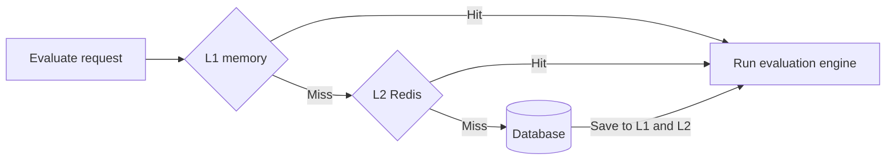

# Flag Config Caching

This document explains how we cache flag configurations for the evaluate endpoint.

The approach is similar to [API key caching](api-key-verification.md). We'll use the same L1 (in-memory) + L2 (Redis) caching strategy, along with request coalescing to avoid duplicate database queries.

## The Problem

Currently, every time someone evaluates a flag, we fetch its configuration from the database.

This involves loading:

1. The flag itself, using its project ID and key.
2. Its rules and their conditions.
3. Its variants, if it's a multivariate flag.

The actual evaluation logic ([evaluate.ts](../apps/api/src/modules/evaluate/evaluate.ts)) is already pure. It doesn't make any database calls or perform any I/O. The expensive part is loading all the data needed for evaluation.

Since flag configurations don't change with every request, we're repeatedly fetching the same data from the database. This is unnecessary and adds avoidable database load and latency.

## What We Cache

We'll cache the complete configuration of a flag in a single entry.

```ts
type FlagConfig = {
  flag: {
    id: string;
    key: string;
    enabled: boolean;
    type: "boolean" | "multivariate";
  };
  rules: RuleWithConditions[];
  variants: FlagVariant[];
};
```

The cache key will be:

```text
flag:<projectId>:<flagKey>
```

Including the project ID ensures that flags with the same key in different projects don't conflict.

## How It Works

The evaluation request follows a simple cache lookup flow:



Here's what happens:

1. First, check the local in-memory cache (L1).
2. If it's not there, check Redis (L2).
3. If Redis also doesn't have it, load the complete configuration from the database.
4. Store the result in both caches.
5. Pass the configuration to the evaluation engine.

This means most evaluation requests won't need to hit the database.

We'll also use request coalescing, just like API key caching. If multiple requests for the same flag arrive at the same time and the cache is empty, they'll share a single database query instead of triggering multiple queries.

## Cache Invalidation

Caching is straightforward. Keeping the cache up to date is the more important part.

Flag configurations can change at any time. For example, when someone disables a flag or changes its rules, those changes should take effect quickly.

We'll handle this using Redis Pub/Sub.

Whenever a flag configuration is updated:

1. Commit the changes to the database.
2. Delete the corresponding entry from Redis.
3. Publish the cache key to a Redis Pub/Sub channel.
4. Every API server listening to that channel removes the corresponding entry from its local L1 cache.

This keeps the caches across all API servers in sync.

The following operations must trigger cache invalidation:

| Operation        | Why                                                   |
| ---------------- | ----------------------------------------------------- |
| Update flag      | Values like `enabled` are part of the cached config   |
| Delete flag      | Remove the entry so subsequent evaluations return 404 |
| Replace rules    | Rules and conditions are part of the cached config    |
| Replace variants | Variants are part of the cached config                |
| Create flag      | Clear any previously cached `missing` entry           |

**Important:** Invalidation must happen only after the database transaction has committed. Otherwise, another request could load the old data again before the update is complete.

### Handling Missed Invalidation Events

Redis Pub/Sub doesn't guarantee message delivery. If an API server misses an invalidation message, its local cache could continue serving stale data.

To limit this, we'll keep the L1 TTL short. Even if an invalidation event is missed, the stale entry will expire automatically.

## Negative Caching

Not every requested flag will exist.

Applications might repeatedly evaluate flags that have been deleted or that contain a typo in their key. Without negative caching, every such request would result in a database query followed by a 404 response.

To avoid this, we'll also cache missing flags.

Instead of storing a full configuration, we'll store a special `missing` entry with a short TTL.

When a new flag is created, we'll invalidate its cache key. This ensures that a previously missing flag can be found immediately after creation.

## TTL and Cache Size

These are our initial TTL values. We'll adjust them later based on actual traffic and performance measurements.

| Entry     | L1 (Memory) | L2 (Redis) |
| --------- | ----------: | ---------: |
| `active`  |  10 seconds |  5 minutes |
| `missing` |  10 seconds | 30 seconds |

Flag configurations are larger than API key entries because they also contain rules, conditions, and variants.

Because of this, we'll keep a lower maximum size for the L1 cache, starting at around 5,000 entries.

Assuming each entry takes a few KB, this should use roughly 10–20 MB of memory. This is only an initial estimate and should be validated through actual measurements.
